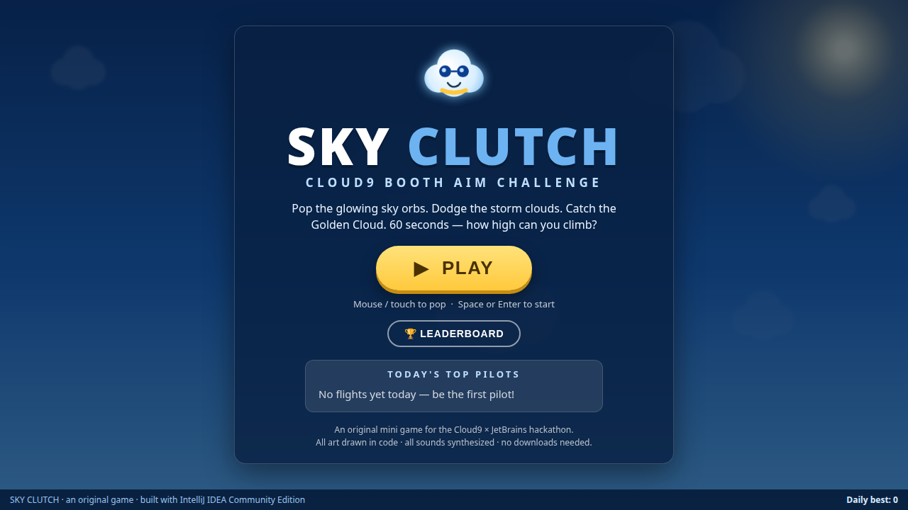
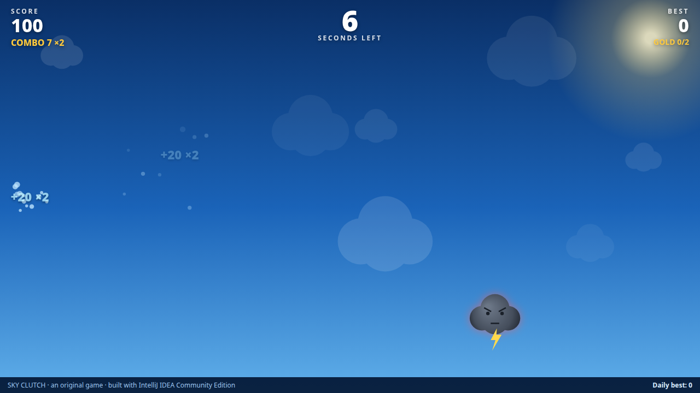

# SKY CLUTCH — Cloud9 Booth Aim Challenge

A 60-second aim / reaction mini game built for the **Cloud9 x JetBrains:
Sky's The Limit Hackathon 2026 — Category 3 (Event Mini Game)**.

Pop glowing sky orbs, dodge the storm clouds, catch the Golden Cloud.
One fast session, instant restart, and a local daily leaderboard that works
with no Wi-Fi — made to run all day on a booth monitor.




## Play it

```bash
python3 -m http.server 8000
# open http://localhost:8000
```

No build step, no dependencies, no network calls. You can also open
`index.html` directly from disk (`file://`) — the game uses no ES modules
and no `fetch`, so it runs standalone.

## How to play

- **Goal:** score as many points as you can in **60 seconds**.
- **Sky orb** (glowing white cloud): click / tap it — **+10 points** × your
  combo multiplier.
- **Combo:** consecutive pops raise your multiplier — every 5 pops adds ×1,
  up to ×5. A storm click resets it.
- **Storm cloud** (dark cloud with lightning): **do NOT click it** —
  −15 points and your combo breaks.
- **Golden Cloud** (rare, golden): **+50 points** × multiplier and **+2
  bonus seconds** (max 2 bonuses per game).
- Clicking empty sky counts as a miss and lowers your accuracy — no other
  penalty.
- **Controls:** mouse, touch, or keyboard — `Space` / `Enter` to start and
  replay, `M` to mute, `R` on the leaderboard screen resets today's board
  (booth staff only).
- **Ranks:** Rookie → Skilled → Pro → Cloud9 → SKY'S THE LIMIT.

When time runs out you get your score, accuracy, best combo, golden clouds
caught, and a rank. Enter a 3-letter callsign to save your score to
**today's top-10 leaderboard** (stored in `localStorage`, on this machine
only).

## Leaderboard display mode (second monitor)

Open `index.html?board=1` on a second screen to show a large, auto-refreshing
top-10 board for the day. It needs no network and no server — just the same
browser profile / machine, since scores live in `localStorage`.

## Features

- Complete loop: menu → 60-second round → score screen → instant replay.
- Attract mode: animated menu with the original mascot **Nimbus** (a little
  cloud pilot, drawn in code).
- Difficulty ramp: targets spawn faster, move faster, and live shorter as
  the round goes on; storm clouds appear more often late in the round.
- All art is drawn with Canvas/CSS; all sounds are synthesized with
  WebAudio. Zero downloaded assets.
- Responsive: plays at 1280×720 on a booth monitor and in portrait on a
  phone.
- `?debug=fast` shrinks a round to 10 seconds (used by the automated
  tests in `verification/`).
- Clean reset between players: one click on PLAY AGAIN clears score,
  combo, targets, timer, and the name form.

## File structure

```
index.html        Page structure: menu, HUD, game-over, leaderboard screens
style.css         All styling (sky theme, HUD, screens, responsive rules)
game.js           Full game: loop, spawning, scoring, audio, leaderboard
LICENSE           MIT License (Gemma Works)
README.md         This file
METHODOLOGY.md    Design approach + how it answers the Category 3 brief
TOOLING.md        JetBrains tooling used (IntelliJ IDEA CE) + evidence
AI_SHOWCASE.md    Case study for the Best AI-Powered Workflow Story bonus
SUBMISSION.md     Copy-paste-ready draft of the Devpost submission form
.idea/            IntelliJ IDEA project files (run configuration included)
verification/     Playwright test log, screenshots, demo video
```

## JetBrains tooling

Built with **IntelliJ IDEA Community Edition 2025.3** — the project was
opened, indexed, and edited in IDEA, validated with **Inspect Code**, and
ships with an IDEA run configuration (`Run Local Server`) that serves the
game on `http://localhost:8000`. See `TOOLING.md` for the full story, and
`AI_SHOWCASE.md` for how an AI coding agent worked together with IDEA.

Junie and JetBrains Air were **not** used: both require a JetBrains account
and a trial code that is only issued after Devpost registration, which needs
the team owner's account. IDEA Community Edition alone already satisfies
the hackathon rule ("at least one JetBrains tool").

## License

MIT — see `LICENSE`. Copyright (c) 2026 Gemma Works.
